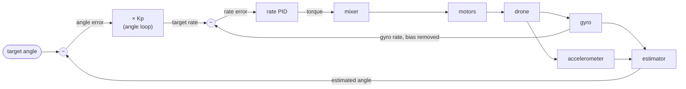

# Stage 2c — The angle loop and start-up calibration

This explains the third item of Stage 2 in [`drone.md`](drone.md#stage-2--host-simulation-self-levelling-attitude):

> Angle loop around the rate loop on roll and pitch; rate loop on yaw; a simple start-up calibration first

After [Stage 2a](Stage2-a.md) the drone can hold a rotation rate, and after [Stage 2b](Stage2-b.md) it knows its roll and pitch angle. This item joins the two. An angle loop takes the angle wanted and the angle estimated and tells the rate loops how fast to turn. With a target of zero on both, the drone returns to level and stays there: it is self-levelling.

[Inner and outer loops](drone.md#inner-and-outer-loops) in `drone.md` gives the idea. This document turns it into formulas, code and tests, and adds the start-up calibration that Stage 2b showed is needed.

## What is in and what is not

| In this item | Not yet |
|---|---|
| an angle loop on roll and on pitch | the disturbance tests: a kick, a 30° start, a weak motor (the next item) |
| the yaw rate loop, unchanged | gravity, movement and hover (Stage 3) |
| a start-up calibration: starting angle and gyro bias | arming and the safety cut-off (Stage 3) |
| one `Controller` in the flight crate that runs all of it | stick input from a receiver |

## The angle loop

### The formula

For roll, and the same for pitch:

```
target rate = Kp × (target angle − estimated angle)
target rate = clamp(target rate, −rate limit, +rate limit)
```

The result is handed to the rate loop of that axis as its setpoint. That is all the angle loop is.

- **The angles are in degrees and the rate in °/s,** so `Kp` is in "°/s per degree". A `Kp` of 6 means: for every degree of error, ask for 6 °/s towards the target.
- **P only.** The rate loops and the motors do the hard work. The angle loop only has to say which way and how fast, and a proportional term does that.
- **It is the `Pid` from Stage 1,** with `Ki` and `Kd` at zero and the output limits set to the rate limit. No new controller code is needed.

### The chain for one axis



How to read it:

- **An arrow** carries one number from one box to the next.
- **A circle with `−`** is a subtraction: the target arriving from the left, minus the measurement arriving on the line that comes back from the drone. Its result is an error.
- **`× Kp`** is the whole of the angle loop's controller: multiply the angle error by `Kp`. It is a PID with only the P term, which is why such a controller is called "P only".
- **`rate PID`** is the rate controller of Stage 1 and Stage 2a, unchanged.
- **The lines that run back** from the drone to the two circles are what make these loops. The inner one goes through the gyro alone. The outer one goes through the estimator, which uses both sensors.

The part up to "target rate" is new in this item, along with the path back through the estimator. From "target rate" onwards it is the rate loop that already exists. The only change to it is where its target comes from: until now the simulation set the target rate, and from now on the angle loop does.

One pass through the chain, for a drone tilted 10° to the right that should be level, with `Kp` = 6 and not turning yet:

| Step | Calculation | Result |
|---|---|---|
| angle error | target angle − estimated angle = 0 − 10 | −10° |
| angle loop | `Kp` × angle error = 6 × −10 | target rate −60 °/s (turn left) |
| rate error | target rate − gyro rate = −60 − 0 | −60 °/s |
| rate PID | its `Kp` of 0.0014 × −60, plus its D term | about −0.084, a torque command |
| mixer | throttle 0.7 with roll −0.084 | left motors 0.616, right motors 0.784 |

The right motors are now stronger, which lifts the right side, and the drone starts to turn left. A millisecond later the same chain runs again with new readings. As the drone comes level the angle error shrinks, the target rate shrinks with it, and it arrives without rushing past.

### Why the drone slows down on its own

`Kp` sets a time. With the rate loop doing as it is told, the angle closes on its target like this:

```
time to cover 63% of the error ≈ 1 / Kp
```

With `Kp` = 6 that is about 0.17 s, and the move is as good as finished after three of those, 0.5 s. A higher `Kp` is faster, until the rate loop can no longer keep up.

### The rate loop has to be faster

The angle loop assumes that when it asks for a rate, it gets it. The rate loops of Stage 2a take about 0.11 s to reach a new rate. If the angle loop changes its mind faster than that, it is steering something that has not yet done the last thing it was told, and the result is overshoot and then oscillation.

The rule of thumb is that the outer loop should be three to five times slower than the inner one. Here that puts `1 / Kp` at 0.15 s or more, so a `Kp` of about 6 or less. The trial under [What to expect](#what-to-expect) agrees.

### The rate limit

The clamp on the target rate caps how fast the drone may turn, whatever the error. Start with **±200 °/s**.

- **It keeps a large error from asking for something absurd.** An error of 60° with `Kp` = 6 would ask for 360 °/s.
- **It is what makes a large move look different from a small one.** Small moves all take the same time, whatever their size. A large one first turns at the limit, then slows as it nears the target.
- **It protects the rate loops' own limit.** A rate step of 200 °/s already drives the motors close to their range.

### Running at 250 Hz

The rate loops run every step, at 1 kHz. The angle loop runs every fourth step, at 250 Hz, and its last answer is held in between.

It does not need to be faster: it steers something that takes a tenth of a second to respond. Running it less often also leaves time in the 1 kHz step for the things that need it. In the trial, running the angle loop at 1 kHz, 250 Hz or 100 Hz gave the same response to within a few milliseconds.

The rate PIDs take their derivative from the measurement, not the error, so the target rate changing in small jumps every fourth step causes no kick. [Derivative kick, worked through](Stage1-a.md#derivative-kick-worked-through) is where that was decided.

### Yaw

Yaw keeps its rate loop and gets no angle loop. No sensor on this drone can tell which way the nose points, so there is no yaw angle to hold. The yaw target is a rate, zero for now.

### A limit: the angles are not the body's axes

The angle loop turns a roll error into a roll **rate** about the body's x axis, and a pitch error into a rate about the body's y axis. Near level those are the same thing. When the drone is tilted a long way, or yawing fast, they are not, for the reason given in [Turning while tilted](Stage2-b.md#turning-while-tilted).

For a self-levelling hover the difference is small and the loop corrects it as it goes, because it works from the error at every step. It is the first thing to revisit if large tilts behave oddly.

## Start-up calibration

[Calibration before flight](drone.md#calibration-before-flight) in `drone.md` explains why. In short: for the first second the motors are off and the drone sits still, and the readings taken then give a clean starting angle and the gyro's bias. This item builds the simple version.

### What it does

For 1000 steps, which is one second:

1. **Add up** the three gyro readings and the three accelerometer readings.
2. **At the end, divide by 1000** to get six averages.
3. **Check** that the drone was still (below).
4. **The three gyro averages are the bias.** From now on they are subtracted from every gyro reading before anything else uses it.
5. **The three accelerometer averages give the starting angle,** through `angles_from_accel`. The estimator is set to it.

Averaging 1000 readings cuts the noise by about 30 times, the square root of 1000.

### The stillness check

The calibration is only right if the drone did not move. Two checks, per gyro axis:

- **The average is small.** A real gyro's bias is a degree or two per second at most. An average above 5 °/s means the drone was turning steadily, and that is not a bias.
- **The readings stayed close to each other.** Track the smallest and largest reading of the window. If they are further apart than a limit, the drone was moved or bumped. The limit has to allow for the sensor's own noise: with noise of 2 °/s, readings a second apart can differ by 13 °/s, so start with a limit of 30 °/s.

One more, on the accelerometer:

- **The average is about 1 g long.** Between 0.9 and 1.1. Anything else means the sensor is faulty or the drone was being shaken.

If any check fails, the window starts again from zero. The motors stay off until a window passes.

### What calibration fixes

Stage 2b found two problems. Both go away:

| Problem | Without calibration | With it |
|---|---|---|
| the estimator starts from one noisy reading | 1.4° off at the start | 0.01° off |
| a gyro bias of 1 °/s | the drone hangs 1.1° from level, for ever | level |

The second row needs a word. With an angle loop, a bias no longer makes the drone turn steadily, as it did under rate control alone. The angle loop notices the tilt and holds against it. But it holds at the wrong place: the estimator is 1° off because of the bias (bias × τ), and the angle loop needs a further 0.17° of error (bias ÷ `Kp`) to command the 1 °/s that cancels the bias. Subtracting the measured bias removes both.

## The controller

Until now the simulation has done the flight code's sequencing itself: read the sensors, run the PIDs, call the mixer. With calibration, an estimator and two rates of loop, that sequence is now real logic, and the firmware needs exactly the same one. So it moves into the flight crate as one type, the `Controller`.

The simulation, and later the firmware, then does only three things each step: read the sensors, call the controller, write the motor commands.

### What it does each step

```
update(gyro, accel, targets, dt) -> motor commands

Calibrating:
    feed the readings to the calibration
    when it is done: store the bias, set the estimator, start flying
    return all four motors off

Flying:
    1. subtract the bias from the gyro reading
    2. update the estimator
    3. every fourth step: run the two angle loops, to get two target rates
    4. run the three rate PIDs
    5. mix, and return the four motor commands
```

### Shape of the code

```
drone/flight/
    calibration   Calibration
                      update(GyroRates, Accel) -> CalibrationStatus
    estimator     Estimator::set_attitude(Attitude)        new
    controller    Controller
                      update(GyroRates, Accel, Targets, dt) -> MotorCommands
                      state() -> State
                      attitude() -> Option<Attitude>
                      reset()

drone/sim/
    bin/quad      calls the Controller in place of its own PIDs and mixer
```

The types, all in the flight crate:

| Type | Fields or values | Unit |
|---|---|---|
| `Targets` | `roll`, `pitch`, `yaw_rate`, `throttle` | °, °, °/s, 0 to 1 |
| `CalibrationStatus` | `Collecting`, `Failed`, `Done(CalibrationResult)` | |
| `CalibrationResult` | `gyro_bias` (a `GyroRates`), `attitude` (an `Attitude`) | °/s, ° |
| `State` | `Calibrating`, `Flying` | |
| `Gains` | the gains and limits of the five loops | |

`Targets` is what a pilot's sticks will set later: two angles, a yaw rate and a throttle. In this stage the simulation sets them.

A sketch of the angle loop inside the controller:

```rust
// Every fourth step, with `attitude` from the estimator.
if self.step % ANGLE_LOOP_DIVIDER == 0 {
    let angle_dt = dt * ANGLE_LOOP_DIVIDER as f32;
    self.roll_rate_target = self.roll_angle_pid.update(targets.roll, attitude.roll, angle_dt);
    self.pitch_rate_target = self.pitch_angle_pid.update(targets.pitch, attitude.pitch, angle_dt);
}
self.step += 1;

// Every step.
let roll = self.roll_rate_pid.update(self.roll_rate_target, gyro.roll, dt);
let pitch = self.pitch_rate_pid.update(self.pitch_rate_target, gyro.pitch, dt);
let yaw = self.yaw_rate_pid.update(targets.yaw_rate, gyro.yaw, dt);

mix(MixerInput { throttle: targets.throttle, roll, pitch, yaw })
```

It has not been compiled.

### Choices to make in the code

- **Where the gains live.** A `Gains` struct passed to `Controller::new`, with a `Default` that holds the values chosen so far. The simulation's command-line arguments then fill one struct, and the firmware uses the default.
- **The angle loop's `dt`.** It runs every fourth step, so the time since its last run is four steps. With P only this changes nothing, but the `Pid` should be told the truth in case an I or D term is ever added.
- **`reset()`.** Back to `Calibrating`, with the PIDs, the estimator and the calibration cleared. Stage 3's disarm will call it.
- **A bad `dt`.** The PIDs and the estimator already guard against it. The controller passes it through and returns their answer.
- **The first-reading rule stays in the estimator** as the fallback for code that does not calibrate, such as the Stage 2b tests.
- **What the simulation logs.** The controller keeps its inner values private, and the CSV wants the estimate and the two target rates. Small getters for those are enough; the three PID outputs can be dropped from the CSV, since the four motor commands show the same thing.

### In the physics

One addition: the body needs a way to start tilted, for the next item's "from a 30° start" test and for this item's test that calibration works on a slope.

- **`Quad::set_attitude(roll, pitch, yaw)`,** in radians, which builds the quaternion from three angles. With zero rates and equal motor commands the body then stays there.

## Tests

### The calibration (`flight`)

| Test | Setup | Expected |
|---|---|---|
| Collecting until full | 999 updates | `Collecting` every time |
| Done on the last one | the 1000th update | `Done` |
| Bias is the average | a constant gyro reading of (1, −2, 0.5) °/s, level accelerometer | `gyro_bias` (1, −2, 0.5) |
| Starting angle | zero gyro, an accelerometer reading for 10° of roll | `attitude` roll 10°, pitch 0° |
| Noise is averaged | level, with noise on all six readings | bias within 0.3 °/s of zero, angle within 0.3° of level |
| Turning steadily | a gyro reading of 10 °/s | `Failed` |
| Bumped | still, with one reading of 50 °/s in the middle | `Failed` |
| Wrong size of gravity | an accelerometer reading 1.5 g long | `Failed` |
| Starts again after failing | a failed window, then 1000 good updates | `Done` |

### The angle loop (`flight`)

These need no body. They check the `Controller` from outside, by feeding it readings and looking at what it asks the motors for. "More power" means a larger motor command, a number from 0 to 1; it says nothing about where the motor is.

| Test | Setup | Expected |
|---|---|---|
| Motors off while calibrating | the first 1000 updates | all four commands 0 |
| Flying after calibrating | the 1001st update, level, targets zero, throttle 0.7 | all four 0.7 |
| Tilted right, target level | readings for 10° of roll, zero rates | right motors get more power than the left ones, to lift the right side |
| Tilted nose up, target level | readings for 10° of pitch, zero rates | back motors get more power than the front ones, to lift the tail and bring the nose down |
| Target right, drone level | target roll 10°, level readings | left motors get more power than the right ones, to push the right side down |
| Yaw untouched by tilt | readings for 10° of roll | no yaw part: `fl + br` equals `fr + bl` |
| Rate limit | readings for 80° of roll | the same commands as for 60°: both ask for the limit |
| Bias is removed | calibrate with a gyro reading of 1 °/s; then the same reading while flying | the same commands as with no bias at all |
| Runs every fourth step | change the target between two steps that are not a fourth step | the commands do not change until the next fourth step |
| Reset | fly, `reset()` | `Calibrating` again, motors off |

### The whole loop on the body (`sim`)

| Test | Setup | Expected |
|---|---|---|
| Holds level | targets zero, 3 s | roll and pitch within 0.1° of 0 |
| Roll step | target roll 20° | reaches 18° within 0.4 s, overshoot under 2%, ends within 0.2° of 20° |
| Pitch step | the same about pitch | the same |
| Negative step | target roll −20° | the same, negative |
| Levels from a tilt | the body starts at 20° of roll, targets zero | back within 1° of level in under 0.6 s |
| Calibrates on a slope | the body starts at 10° of roll and stays there through calibration; then target 10° | no jump when the motors start: the roll stays within 0.5° of 10° |
| Bias, calibrated | gyro bias 1 °/s, targets zero, 6 s | true roll within 0.2° of 0 |
| Two axes at once | target roll 15° and pitch −10° | both reached, yaw rate stays under 2 °/s |

## In the simulation

The quad program changed shape. Each step it reads the sensors, calls one `Controller` and steps the body; it no longer runs PIDs, a mixer and an estimator of its own.

```
cd drone/sim
cargo run --bin quad > quad.csv
python3 plot_angles.py
python3 measure_angles.py quad.csv
```

- **The run:** one second of calibration with the motors off, then the targets apply. The step is a step in **angle**: the chosen axis is asked for 20° from 1.5 s to 3.5 s, then level again. The run is 5 s.
- **`--axis`** takes `roll` or `pitch` for an angle step, or `yaw` for a rate step of 50 °/s. `--target` changes the size of either.
- **`--angle-kp` and `--rate-limit`** set the angle loops.
- **`--start-roll` and `--start-pitch`** start the body tilted, in degrees.
- **`--no-calibration`** shows what the calibration is worth. The motors still stay off for the first second, but the controller then starts as it would with no calibration: the gyro bias taken as zero, and the starting angle from one accelerometer reading.
- **CSV columns:** `roll_angle_target` and `pitch_angle_target`; the rate targets, which the angle loops now set; and `state`, which is 0 while calibrating and 1 while flying. The estimate columns are `NaN` while calibrating.
- **`plot_angles.py`** draws six panels: the angle and the rate of roll, the same for pitch, the yaw rate, and the motors. One picture shows the angle following its target and the rate following what the angle loop asks for. The calibration is shaded.
- **`measure_angles.py`** prints the rise time, overshoot and settling time of the angle step, and how well the angle is held afterwards.

The Stage 2a and 2b pictures were made by the rate-only program. Their scripts need the old behaviour, so the program keeps a `--rate-only` switch: three rate PIDs and the mixer held in the program, rate targets as before, no calibration, and the old 3 s run. Its output is the same, byte for byte, as before the change.

[`drone/sim/README.md`](drone/sim/README.md#the-quad) lists all the arguments and the CSV columns.

## Results

The calibration, the controller and the tilted start are written, with the tests above, and the quad program runs the whole loop. `./stage2-c.sh` in `drone/sim/` saves the pictures in [`drone/sim/stage2-c/`](drone/sim/stage2-c/README.md). Each run is 5 s, with a step of 20° of roll from 1.5 s to 3.5 s unless stated.

| Run | Rise to 90% | Overshoot | Settled within 5% | Off target at the end of the step |
|---|---|---|---|---|
| no noise | 0.284 s | 0.1% | 0.326 s | 0° |
| the same about pitch | 0.284 s | 0.1% | 0.326 s | 0° |
| real: gyro noise 2 °/s, delay 2 steps, accelerometer noise 0.5 m/s², gyro bias 1 °/s | 0.283 s | 0.5% | 0.328 s | 0.10° |
| real, with no calibration | 0.353 s | never arrives | never | 1.23° |
| angle `Kp` 3 | 0.675 s | none | 0.856 s | 0.09° |
| angle `Kp` 12 | 0.161 s | 18% | 0.344 s | 0° |
| a step of 45° | 0.315 s | 0.1% | 0.359 s | 0° |
| a step of 45°, rate limit 100 °/s | 0.488 s | none | 0.540 s | 0° |

"Off target" is the largest distance of the true angle from the target over the last 0.5 s of the step.

- **The figures are the ones the trial gave.** The real controller matches the table in [What to expect](#what-to-expect) below: 0.28 s, 0.1% and 0.33 s at `Kp` = 6, and 18% of overshoot at `Kp` = 12.
- **`Kp` = 6 stays.** Half of it is more than twice as slow. Twice it rises sooner but overshoots, and settles no sooner.
- **Noise, delay and bias barely show, once calibrated.** The real run differs from the clean one by 0.4% of overshoot and 0.1° of wobble.
- **The calibration is worth about a degree.** Without it the drone holds 18.8° when asked for 20°, and about −1° when asked for level. The estimate starts 1.4° off, from one noisy reading, and the bias then holds it about 1° from the truth. The controller steers the estimate onto the target, so it is the true angle that is wrong.
- **A tilted start is handled.** Starting at 20° of roll, with the real sensors, the calibration finds the angle and the drone is within 1° of level 0.33 s after the motors start.
- **The rate limit does what it should.** A 45° step is asked for 200 °/s for part of the way. With the limit at 100 °/s it takes half as long again and does not overshoot.

Two things that the runs showed and the plan above did not foresee:

- **Without calibration the drone also yaws, at −1 °/s.** Yaw has no angle loop. Its rate loop sees the biased gyro read zero and is content, so the drone turns steadily, and nothing in this controller would ever notice. Calibration is the only thing that stops it: with the bias removed, the true yaw rate stays at 0. A gyro's bias drifts as it warms up, so on the real drone a slow yaw drift will come back during a flight. Holding a heading needs a compass or another reference, which is outside Stage 2.
- **The yaw step still drives two motors to full.** A 50 °/s yaw step puts the two counter-clockwise motors at 1.0 for a moment and the other two at 0.4, as it did in Stage 2a. While a motor is at its limit the mixer cannot give roll and pitch what they ask for. The yaw gain and a limit on the yaw rate asked for are still to tune.

## What to expect

From a trial with the real rate loops, estimator, mixer and body, and an angle loop written for the trial. The step is 20° of roll; the rate loops have the Stage 2a gains.

| Angle `Kp` | Rise to 90% | Overshoot | Settled within 5% | Largest rate asked for |
|---|---|---|---|---|
| 2 | 1.06 s | none | 1.36 s | 40 °/s |
| 4 | 0.48 s | none | 0.60 s | 80 °/s |
| **6** | **0.28 s** | **0.1%** | **0.33 s** | **120 °/s** |
| 8 | 0.21 s | 5% | 0.34 s | 160 °/s |
| 12 | 0.16 s | 18% | 0.34 s | 200 °/s (the limit) |
| 20 | 0.15 s | 29% | 0.59 s | 200 °/s (the limit) |

**Start with `Kp` = 6.** It is the fastest value that does not overshoot, and above it the settling time stops improving. This is where the rule of thumb put it.

With gyro noise of 2 °/s, a delay of two steps, accelerometer noise of 0.5 m/s² and calibration, `Kp` = 6 gives almost the same figures: rise 0.28 s, overshoot 0.5%, settled in 0.33 s. Holding level, the true angle wobbles by about 0.05°.

Other things the trial showed:

| Run | Result |
|---|---|
| steps of 5° and 20° | the same rise time, 0.28 s: below the rate limit, the time does not depend on the size of the move |
| a step of 45° | 0.32 s; the target rate sits at the 200 °/s limit for part of the way |
| a step of 45° with the limit at 100 °/s | 0.49 s, with no overshoot |
| angle loop at 1 kHz, 250 Hz and 100 Hz | rise 0.288, 0.284 and 0.278 s: no real difference |
| gyro bias 1 °/s, no calibration | the drone settles 1.14° from level and stays |
| the same, calibrated | level |
| bias and noise together, calibrated | 0.13° from level |
| yaw `Kp` lowered from 0.01 to 0.003 | motor jitter falls from 0.024 to 0.014, with the roll response unchanged |

The last row is a reminder that the yaw gain is still the first guess from Stage 2a and passes a lot of gyro noise to the motors. Tuning it belongs with this item.

The picture to look for: the angle rising smoothly to its target with no bump at the top, the rate drawing one clean hump underneath it, and nothing at all happening on the other two axes.

## Where this goes next

- The last Stage 2 item is the disturbance tests: a kick, a 30° start and one weak motor, explained in [`Stage2-d.md`](Stage2-d.md). A weak motor is a steady torque, which the rate loops have no I term to cancel yet; that test is likely to be where `Ki` earns its place.
- Stage 3 adds gravity and movement. The throttle then decides whether the drone climbs, and a tilt makes it slide sideways, so "level" starts to mean "not drifting".
- Stage 3 also turns the simple calibration into arming: disarmed, calibrating, armed, and a cut-off when the tilt passes a safe angle.
